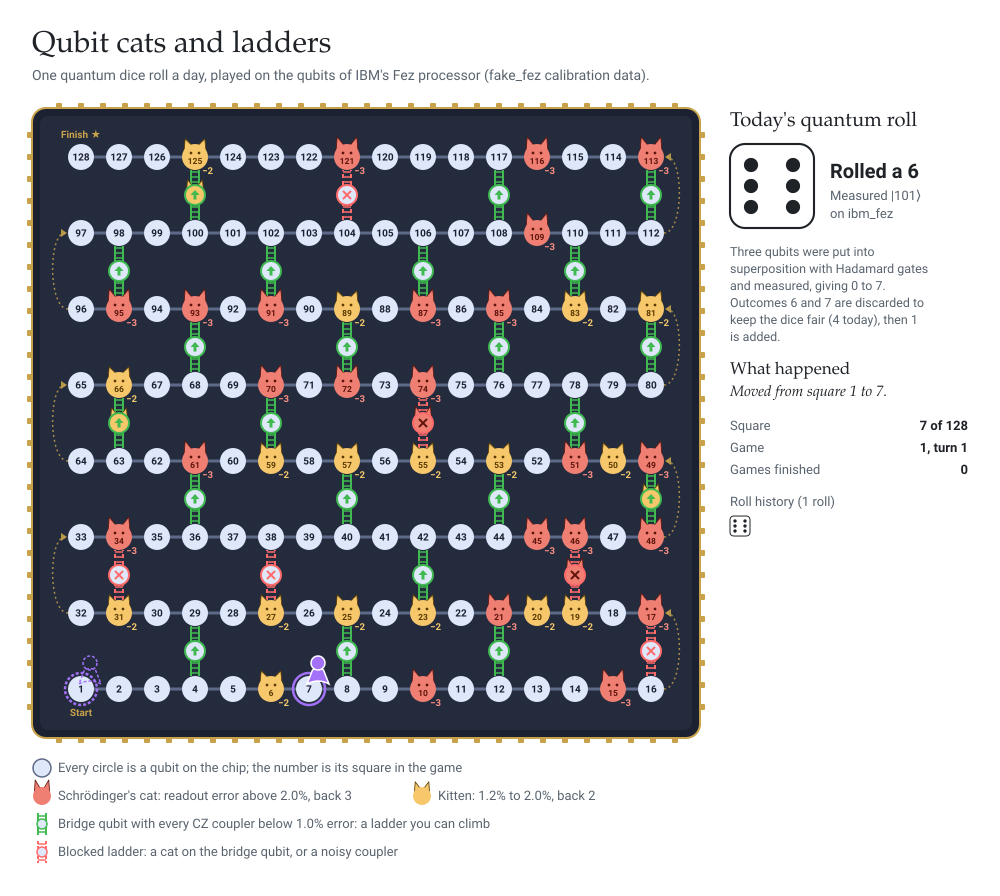

# Hi, I'm Sarah

I'm a Principal Consultant in AI, data and emerging tech, with a background in physics. Outside client work I build quantum computing side projects, including [qem-benchmark](https://github.com/SarahLittlejohn/qem-benchmark).

## Qubit snakes and ladders

A game that plays itself, one move a day. The board is the heavy-hex layout of IBM's Fez processor: each square is a qubit and each ladder is a bridge qubit linking two rows. Noisy qubits act as snakes: land on a storm (readout error above 2%) and you go back 3 squares, or on choppy water (1.2% to 2%) and you go back 2. You can climb a ladder only if it's green, meaning every rung has a CZ error below 1% and the qubit in the middle isn't a storm.

Every morning at 07:30 UTC a [GitHub Action](.github/workflows/qubit-snakes.yml) runs [qubit_snakes.py](qubit_snakes.py), which rolls the dice by putting three qubits into superposition on a real IBM Quantum processor and measuring them.
