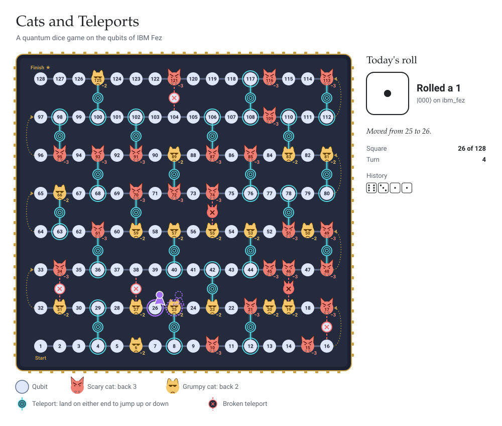

**Cats and Teleports** plays itself, one roll a day, on the qubits of IBM Fez. Cats on noisy qubits send you back; teleports on the bridge qubits jump you up or down a row. The dice is three qubits in superposition, measured on a real IBM Quantum processor by a [daily Action](.github/workflows/cats-and-teleports.yml).
