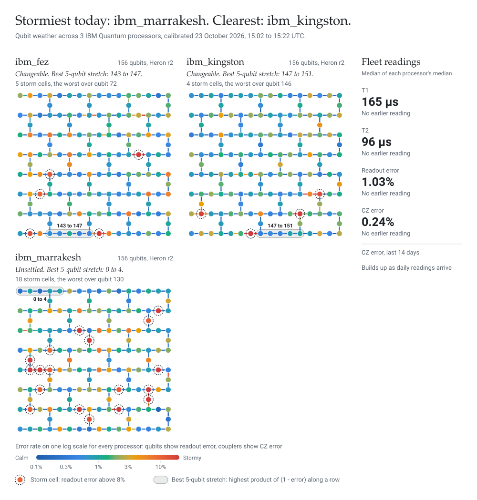

# Hi, I'm Sarah

I'm a Principal Consultant in AI, data and emerging tech, with a background in physics. Outside client work I build quantum computing side projects, including [qem-benchmark](https://github.com/SarahLittlejohn/qem-benchmark).

## Today's qubit weather

A daily weather map of the IBM Quantum processors on the Open Plan, drawn from their real calibration data. Each dot is a qubit coloured by readout error and each line is a coupler coloured by two-qubit gate error, on one log scale from calm blue to stormy red, so the processors can be compared directly. Dashed rings mark storm cells (readout error above 8%), and the shaded bar is the best five-qubit chain of the day.

A [GitHub Action](.github/workflows/qubit-weather.yml) runs [qubit_weather.py](qubit_weather.py) every morning at 07:30 UTC. It only reads calibration data, so no jobs are submitted and no QPU time is used.
